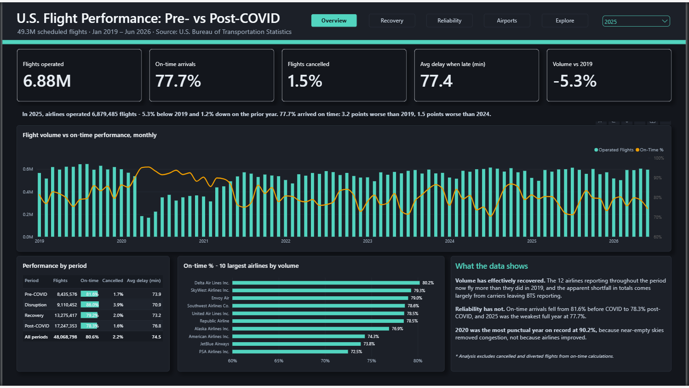
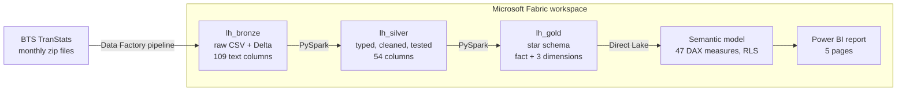
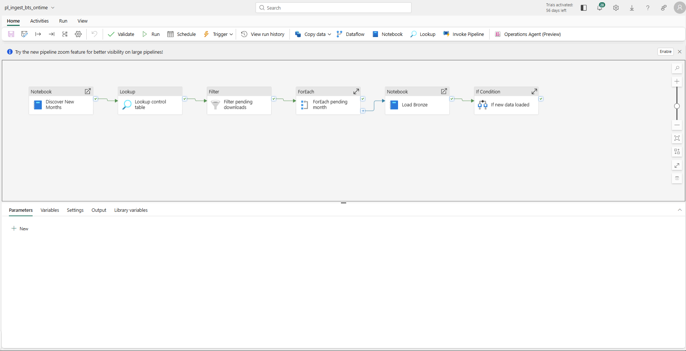
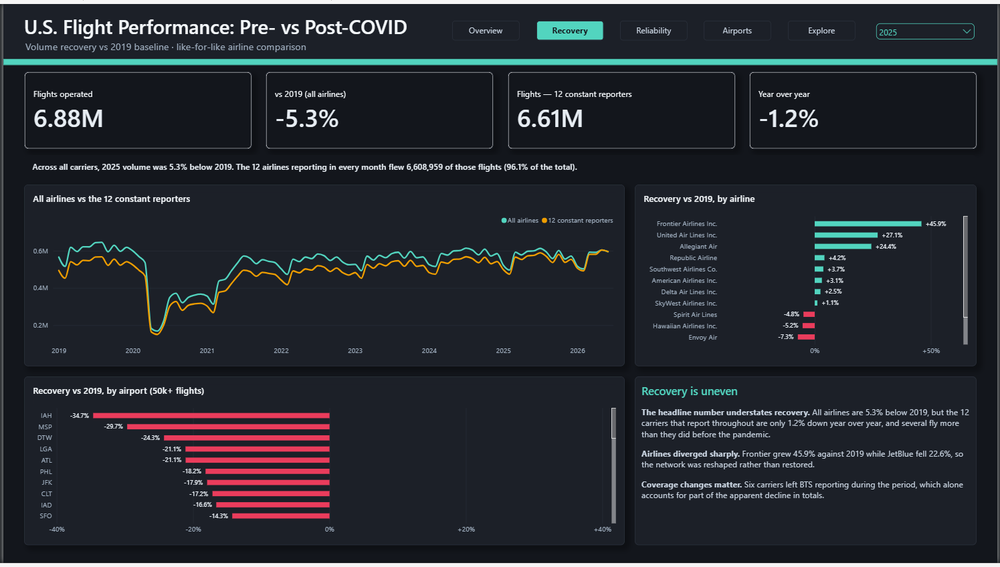
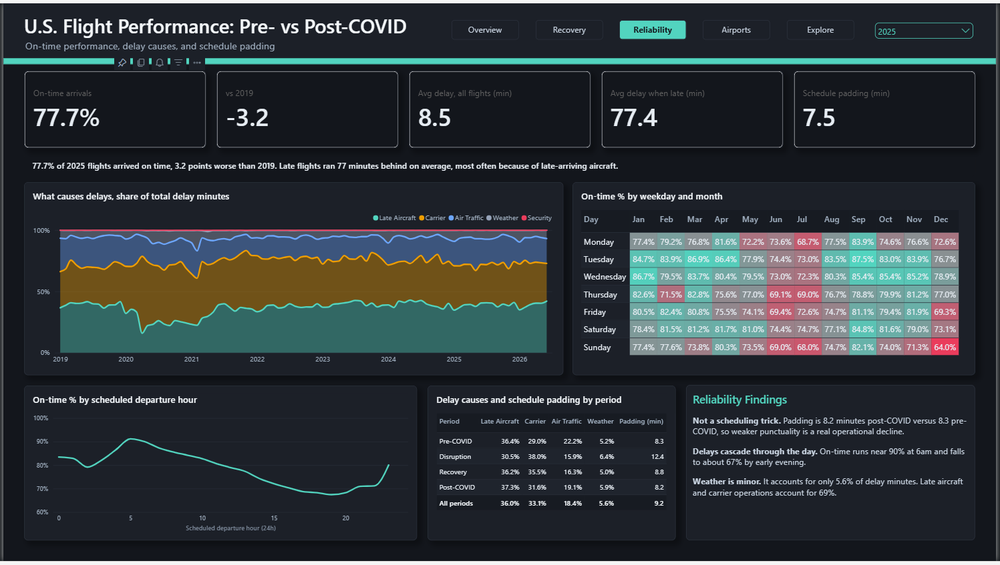
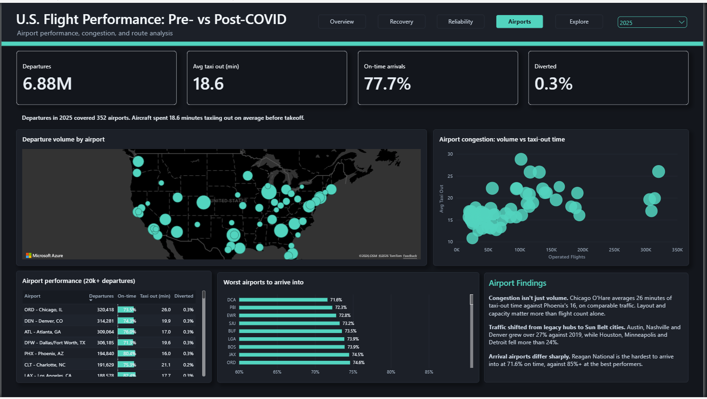
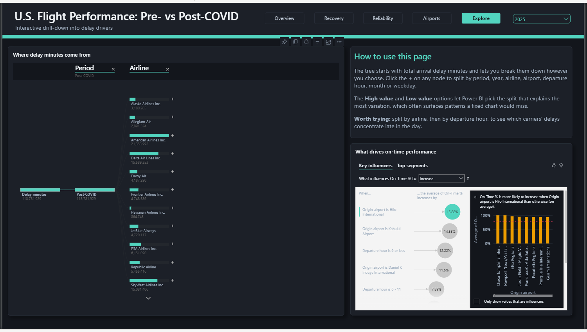

# U.S. Flight Performance: Pre- vs Post-COVID

I wanted to answer a simple question with real data: did U.S. air travel recover from COVID, and is it as reliable now as it was in 2019?

To find out, I built an end-to-end Microsoft Fabric solution over 49.3 million flight records published by the U.S. Bureau of Transportation Statistics, from automated ingestion all the way to a Power BI report.

The numbers below come from the January 2019 to June 2026 data. The pipeline keeps running, so the live report covers more months than that.



## What I found

The headline number says volume hasn't recovered: in 2025, U.S. airlines flew 5.3% fewer flights than in 2019. But that figure is misleading. Six carriers entered or left the federal reporting set during the period. When I compared only the 12 airlines that reported in every single month, they now fly 3.4% more flights per month than before COVID, and they carry 96.1% of all traffic.

Reliability is a different story. On-time arrivals dropped from 81.6% before COVID to 78.3% after, and 2025 was the worst full year in the data at 77.7%. I checked whether airlines were padding their schedules to hide it. They aren't: average padding stayed flat (8.3 minutes before, 8.2 after), so the decline is real.

A few other things stood out:

- 2020 was the most punctual year (90.2%), simply because the skies were nearly empty.
- Delays build up through the day. Flights leaving around 5–6am arrive on time about 90% of the time. By 7–8pm, that drops to about 67%.
- Weather causes only 5.6% of delay minutes. Late-arriving aircraft and airline issues cause 69%.
- The network was reshaped rather than restored. Compared with 2019, Frontier grew 45.9% while JetBlue shrank 22.6%. Traffic moved away from hubs like Houston IAH (−34.7%), Minneapolis (−29.7%) and Detroit (−24.3%) toward Austin (+30.4%), Nashville (+27.8%) and Denver (+27.5%).

## How it's built



The data moves through three Lakehouse layers:

- **Bronze** keeps every source file exactly as it arrived, with all columns as text, plus the file name and load time for auditing.
- **Silver** cleans and types the data, adds flight status and timestamps, and flags data quality issues. A set of tests runs at the end and stops the pipeline if anything fails.
- **Gold** is a star schema: one fact table of scheduled flights, with date, airline and airport dimensions, reconciled back to Silver.

The Power BI semantic model reads Gold directly through Direct Lake, so there is no import refresh to schedule.

### The pipeline



It runs every Tuesday at 02:00 (Gulf time) in this order: discover new months, download each one, load Bronze, and then, only if new data arrived, transform Silver and build Gold.

- It checks the BTS server for newly published months by requesting a single byte instead of the full file, then adds them to a control table.
- The control table tracks each month as pending, downloaded or loaded. A month that fails stays pending and is retried on the next run, so nothing is ever loaded twice.
- If no new month arrived, Silver and Gold are skipped. A run with nothing new takes about 2.5 minutes instead of 30.
- All notebooks share one Spark session. Without this, the trial capacity rejected the second notebook's session request.

The first full load downloaded 87 monthly files in 39 minutes and loaded them in 35, with no failures.

## Data quality

Before writing any cleaning rules, I profiled the data first (see the nb_98_data_profiling notebook). Here's what I found and how I handled it:

| Finding | How I handled it |
|---|---|
| Each row is a scheduled flight, and cancellations are included. In March 2020, 17% of flights were cancelled. In April 2020, 41.5%. | All volume and reliability numbers are based on flights that actually operated, not row counts. |
| 84.4% of 2020 cancellations (237,189) were coded as "security", compared with almost none in any other year. This looks like a pandemic-era reporting practice, not real security events. | I kept the official code and added a flag so the report can show these separately. |
| Six carriers joined or left BTS reporting partway through. | A flag on the airline table drives the like-for-like comparisons. |
| Midnight is recorded as 2400 (about 29,000 times). | Rolled over to 00:00 the next day when building timestamps. |
| 3,055 flights arrived more than 24 hours late. | Kept, because they're real, but flagged since they distort averages. |
| No duplicate flights, and delay causes add up to total delay for 99.999% of late flights. | Tests check both on every future load. |

Row counts match at every layer: 49,251,865 in Bronze, Silver and Gold, and the operated, cancelled, diverted, on-time and delayed totals match too.

## The report

| Page | What it answers |
|---|---|
| **Overview** | Volume and punctuality compared with 2019 and the previous year |
| **Recovery** | All airlines vs the 12 that reported throughout, by airline and airport |
| **Reliability** | Delay causes over time, the time-of-day buildup, weekday and month patterns, schedule padding |
| **Airports** | Departure map, congestion (volume vs taxi-out time), hardest airports to arrive into |
| **Explore** | Decomposition tree and key influencers for self-service drill-down |

Each page opens with a short summary sentence written in DAX, which updates when you change the year. The full report is also available as a [PDF](report/flight_performance_report.pdf).

| | |
|---|---|
|  |  |
|  |  |

## A few modeling choices

- **Fair comparisons with 2019.** When looking at a partial year, the model compares it only with the same calendar days in 2019. Without this, the first half of 2026 looked 53% down instead of 3.9%.
- **One airport table, two roles.** The same airport table serves as both origin and destination. The destination relationship is inactive and switched on in DAX only when needed.
- **Honest axes.** Airline on-time rates all sit between about 72% and 82%, so those charts start at 60%. I added data labels so the differences aren't exaggerated.
- **RLS with Direct Lake.** The model has a demo row-level security role, but Direct Lake connects through single sign-on, so queries run as the person viewing the report. Anyone with access to the Lakehouse could read the tables directly, which means this role demonstrates the technique rather than securing anything. In production the connection would use a fixed identity with SSO turned off, which is what makes the role enforceable.
- **A known limitation.** Key influencers ranks some small airports highly because it doesn't weight by traffic, so I don't rely on those results. The time-of-day and weekday effects, on the other hand, show up consistently across three separate views.

## Repository

```
notebooks/
  nb_00_setup_control.ipynb      control table and lookup load (one-time)
  nb_01_bronze_ingest.ipynb      Bronze load, run by the pipeline
  nb_02_silver_transform.ipynb   Silver build and tests
  nb_03_gold_model.ipynb         star schema and tests
  nb_04_discover_months.ipynb    new-month discovery
  nb_98_data_profiling.ipynb     profiling behind the cleaning rules
  nb_99_validation.ipynb         Bronze validation
pipeline/pl_ingest_bts_ontime.json
model/sm_flight_performance.bim
report/flight_performance_report.pbix, flight_performance_report.pdf
docs/screenshots/
```

Workspace and item IDs in these files have been replaced with placeholders.

### Running it yourself

1. Create a Fabric workspace with three Lakehouses: lh_bronze, lh_silver and lh_gold.
2. Import the notebooks and attach the Lakehouses listed in each one, with lh_bronze as the default.
3. Download the BTS lookup files L_AIRLINE_ID.csv and L_AIRPORT_ID.csv into lh_bronze (Files/raw/bts_lookups), then run nb_00_setup_control.
4. Create an anonymous HTTP connection to the BTS download server (transtats.bts.gov/PREZIP), import the pipeline, and point the placeholders to your own items.
5. Run the pipeline, then deploy the .bim file with Tabular Editor and update its OneLake connection.

To load the full archive back to 1987, just widen the date range in the control table.

## Data source

[Reporting Carrier On-Time Performance](https://www.transtats.bts.gov/DL_SelectFields.aspx?gnoyr_VQ=FGJ&QO_fu146_anzr=b0-gvzr), U.S. Bureau of Transportation Statistics, January 2019 onward, with each new month loaded automatically as BTS publishes it. It covers domestic flights by U.S. airlines above the BTS reporting threshold. Public domain.

## Tools

Microsoft Fabric (Data Factory, Lakehouse, Spark), PySpark, Delta Lake, Power BI (Direct Lake, DAX, RLS), Tabular Editor 2 with Best Practice Analyzer, and AI-assisted development with Claude.

---

**Zia Malik**
