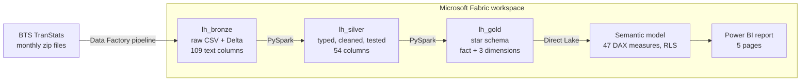

# U.S. Flight Performance: Pre- vs Post-COVID

**An end-to-end Microsoft Fabric solution over 49.3 million U.S. government flight records, from automated ingestion to a Direct Lake Power BI report.**


## The question

Did U.S. air travel recover from COVID, and is it as reliable now as it was in 2019?

## What the data shows

- **Volume has effectively recovered, but the headline number hides it.** Across all airlines, 2025 ran 5.3% below 2019. But six carriers left the federal reporting set during the period. The 12 airlines that reported in all 90 months now operate 3.4% *more* flights per month than before COVID, and they carry 96.1% of all flights.
- **Reliability has not recovered.** On-time arrivals fell from 81.6% before COVID to 78.3% after it. 2025 was the weakest full year in the series, at 77.7%.
- **The decline is operational, not a scheduling artifact.** Airlines pad scheduled flight times to protect on-time statistics. Padding is flat (8.3 minutes pre-COVID, 8.2 post-COVID), so the drop in punctuality is real.
- **2020 was the most punctual year on record (90.2%)**, because near-empty skies removed congestion, not because airlines got better.
- **Delays cascade through the day.** Flights scheduled to depart around 5–6am arrive on time about 90% of the time. By 7–8pm that falls to about 67%.
- **Weather is a minor cause.** It accounts for 5.6% of delay minutes. Late-arriving aircraft and airline operations together account for 69%.
- **The network was reshaped, not restored.** Against 2019, Frontier grew 45.9% while JetBlue fell 22.6%. Traffic shifted from legacy hubs (Houston IAH −34.7%, Minneapolis −29.7%, Detroit −24.3%) to Sun Belt cities (Austin +30.4%, Nashville +27.8%, Denver +27.5%).

## Architecture



| Layer | Contents |
|---|---|
| **Bronze** | Every source file landed as-is, all columns kept as text, plus audit columns (source file, load time). Partitioned by month. |
| **Silver** | Typed and renamed columns, flight status, timestamps, data quality flags. Guarded by a test suite that fails the pipeline on any error. |
| **Gold** | `fact_flights` (one row per scheduled flight) with `dim_date`, `dim_airline` and `dim_airport`, all reconciled back to Silver. |
| **Model** | Direct Lake semantic model: role-playing airport dimension, time intelligence, seasonally fair 2019 baselines, dynamic narrative measures, and a demo RLS role. |

## Pipeline


`Discover New Months → Lookup → Filter → ForEach (download) → Load Bronze → If new data → Transform Silver → Build Gold`

- **Automatic discovery.** Each run checks the BTS server for newly published months, requesting a single byte instead of the full file, and queues them in a control table.
- **Control-table ingestion.** Every month is tracked as pending, downloaded or loaded. A failed month stays pending and is retried on the next run, so reruns never duplicate work.
- **Quality gates.** Silver and Gold end with strict tests that raise an error, so bad data cannot reach the report.
- **Cost control.** An If Condition skips Silver and Gold when no new month arrived. A no-op run takes about 2.5 minutes instead of about 30.
- **Shared Spark session.** High-concurrency mode with a session tag lets all notebooks share one Spark session. Without it, the trial capacity rejected the second notebook's session request.
- **Scheduled** weekly (Tuesday 02:00 Gulf Standard Time).

The first full load pulled 87 monthly files in 39 minutes and loaded them in 35, with zero failures and zero retries.

## Data quality

Cleaning rules were derived from profiling the data first ([`nb_98_data_profiling`](notebooks/nb_98_data_profiling.ipynb)), not assumed. Key findings:

| Finding | How it was handled |
|---|---|
| Rows are *scheduled* flights, and cancellations sit inside them. March 2020 had 17% cancelled and April 2020 had 41.5%. | Every volume and reliability metric is based on operated flights, not row counts. |
| 84.4% of 2020 cancellations (237,189) carry the "security" code, against near zero in every other year. This points to a reporting practice during the pandemic, not real security events. | The official code is kept; a `dq_security_code_2020` flag lets the report show those cancellations separately. |
| Six carriers entered or left BTS reporting mid-period. | A `reports_full_period` flag on the airline dimension drives like-for-like measures. |
| Midnight recorded as `2400` (about 29,000 values). | Rolled over to 00:00 the next day when building timestamps. |
| 3,055 arrival delays over 24 hours. | Kept (they're real) and flagged, since they distort averages. |
| Zero duplicate flights; delay causes add up to total delay for 99.999% of late flights. | Uniqueness and reconciliation tests keep both true on future loads. |

Every layer reconciles: 49,251,865 rows in Bronze, Silver and Gold, with operated, cancelled, diverted, on-time and delayed counts matching at each step.

## Report

| Page | Answers |
|---|---|
| **Overview** | Headline volume and punctuality versus 2019 and the prior year |
| **Recovery** | All airlines vs the 12 constant reporters; recovery by airline and airport |
| **Reliability** | Delay causes over time, the departure-hour cascade, weekday × month patterns, schedule padding |
| **Airports** | Departure volume map, congestion (volume vs taxi-out time), hardest airports to arrive into |
| **Explore** | Decomposition tree and key influencers for self-service drill-down |

Each page opens with a sentence written by DAX that updates with the year selected. The full report is available as a [PDF](report/flight_performance_report.pdf).

| | |
|---|---|
|  |  |
|  |  |

## Modeling decisions worth noting

- **Seasonally fair baselines.** Comparisons against 2019 use only the calendar days present in the current selection. Without this, the first half of 2026 compared against all of 2019 showed −53% instead of −3.9%.
- **Role-playing airport dimension.** One airport table serves both origin (active relationship) and destination (inactive, activated with `USERELATIONSHIP`).
- **Truncated axes, with labels.** Airline on-time rates all sit between about 72% and 82%, so those charts start at 60%, and data labels are shown so no difference is exaggerated.
- **Known limitation.** Key influencers ranks some low-volume airports highly, because it doesn't weight by traffic. The departure-hour and weekday effects replicate across three independent views; the airport-level influencers do not.

## Repository

```
notebooks/
  nb_00_setup_control.ipynb      control table and lookup load (manual, one-time)
  nb_01_bronze_ingest.ipynb      Bronze load, driven by the pipeline
  nb_02_silver_transform.ipynb   Silver build and quality gate
  nb_03_gold_model.ipynb         star schema and quality gate
  nb_04_discover_months.ipynb    new-month discovery
  nb_98_data_profiling.ipynb     profiling that produced the cleaning rules
  nb_99_validation.ipynb         Bronze validation
pipeline/pl_ingest_bts_ontime.json
model/sm_flight_performance.bim
report/flight_performance_report.pbix, flight_performance_report.pdf
docs/screenshots/
```

Workspace and item IDs are replaced with placeholders such as `<WORKSPACE_ID>`.

### Reproducing it

1. Create a Fabric workspace with three Lakehouses: `lh_bronze`, `lh_silver`, `lh_gold`.
2. Import the notebooks and attach the Lakehouses listed in each notebook's metadata, with `lh_bronze` as the default.
3. Download the BTS lookup tables `L_AIRLINE_ID.csv` and `L_AIRPORT_ID.csv` to `lh_bronze/Files/raw/bts_lookups`, then run `nb_00_setup_control`.
4. Create an anonymous HTTP connection to `https://transtats.bts.gov/PREZIP/`, import the pipeline, and map the placeholders to your items.
5. Run the pipeline, then deploy the `.bim` with Tabular Editor and repoint its OneLake expression.

The pipeline scales to the full 1987–present archive by widening the control table's date range.

## Data

[Reporting Carrier On-Time Performance](https://www.transtats.bts.gov/DL_SelectFields.aspx?gnoyr_VQ=FGJ&QO_fu146_anzr=b0-gvzr), U.S. Bureau of Transportation Statistics, January 2019 – June 2026. Covers domestic flights by U.S. carriers above the BTS revenue-share reporting threshold. Public domain.

## Tools

Microsoft Fabric (Data Factory, Lakehouse, Spark), PySpark, Delta Lake, Power BI (Direct Lake, DAX, RLS), Tabular Editor 2 with Best Practice Analyzer.

Built with AI-assisted development. The design decisions, data validation and analysis are my own.

---

**Muhammad Zia Ul Haq** · Senior Data Analyst · PL-300 certified
